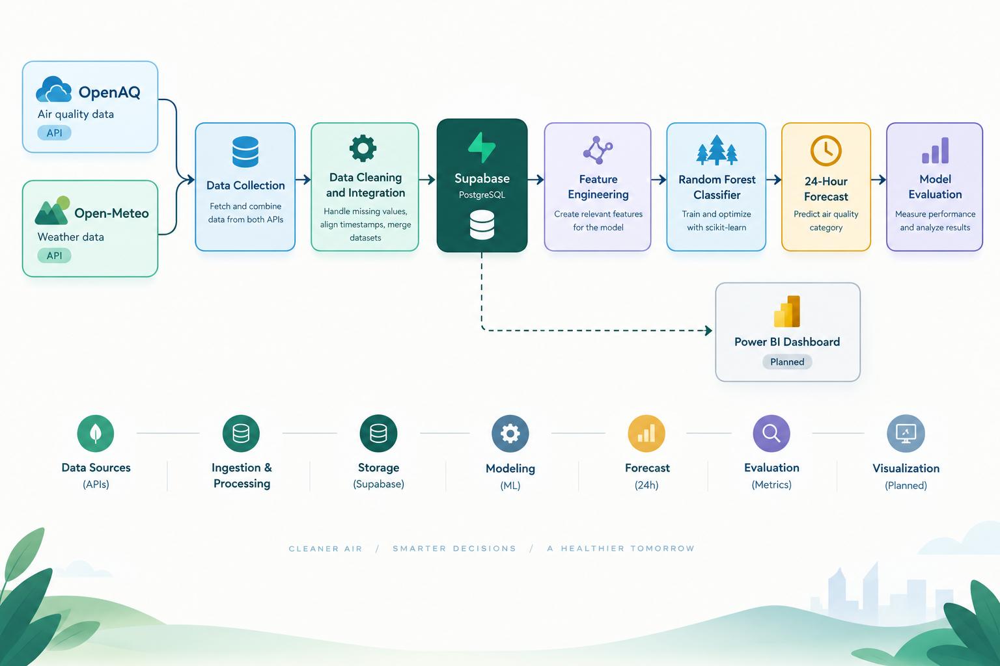
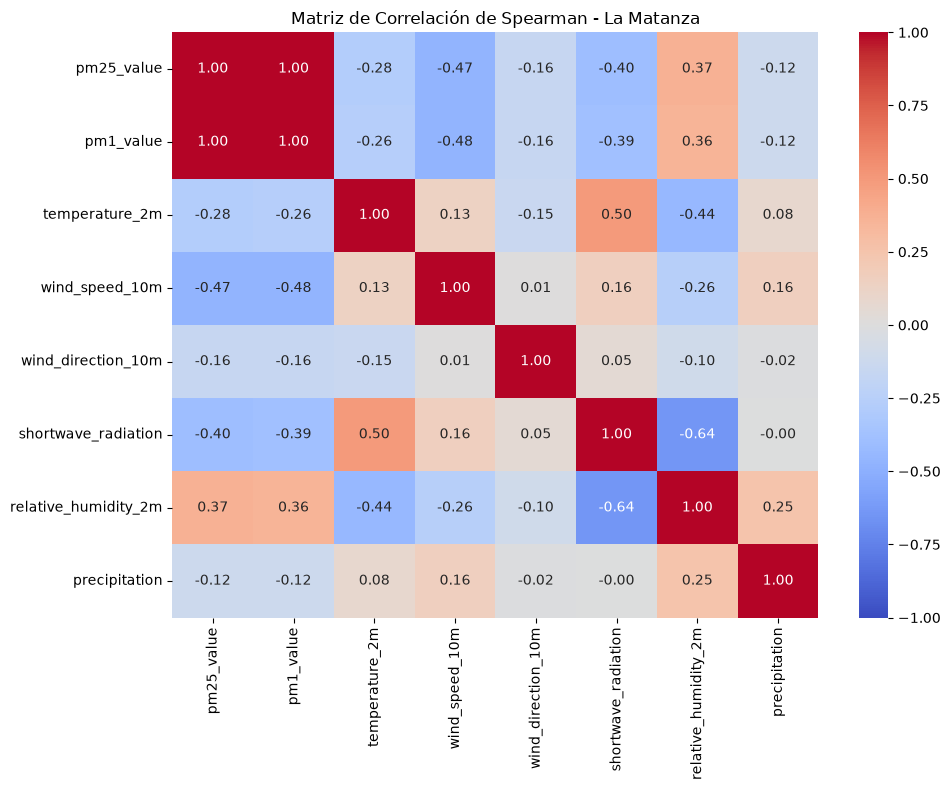
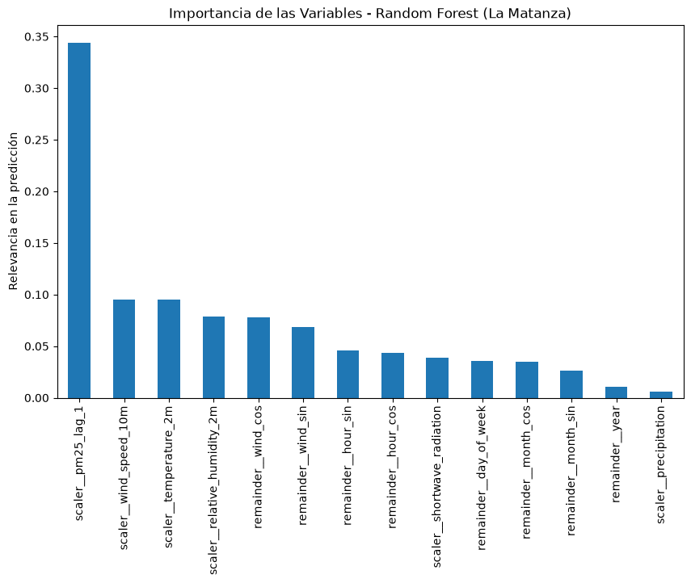
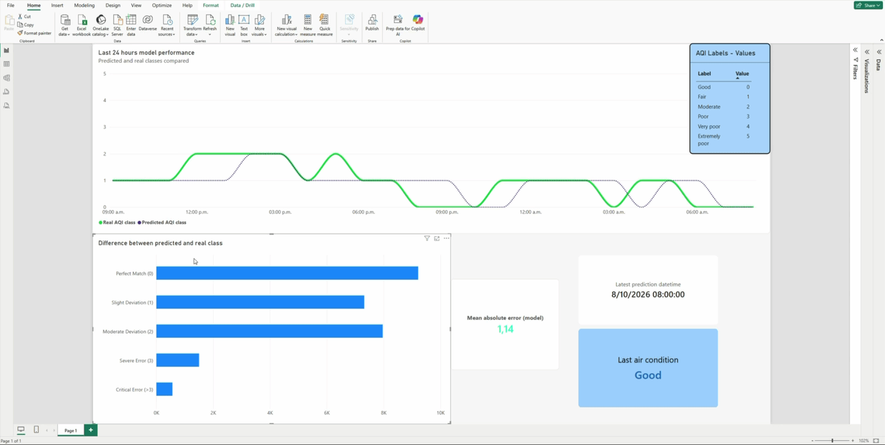

#                                      Air Quality Intelligence

>**A machine learning project for air quality nowcasting using environmental and meteorological data in La Matanza, Buenos Aires, Argentina.**

<p align="center">


</p>

## Overview

Air Quality Predictor is an end-to-end data science project that combines air pollution measurements and meteorological data to estimate air quality categories over the previous 24 hours.

The pipeline automatically integrates historical PM2.5 measurements from [OpenAQ](https://openaq.org/) with meteorological data from [Open-Meteo](https://open-meteo.com/) on a daily schedule. Python handles data processing and machine learning inference, GitHub Actions orchestrates the serverless execution, and Supabase provides PostgreSQL-based data storage.


The goal is to assess recent air quality conditions, identify pollution patterns, and better understand periods of potentially critical air pollution.
## Architecture

The diagram below illustrates the data pipeline, from API ingestion
and data storage to feature engineering and model evaluation.

<p align="center">
  
</p>

The project follows a data pipeline that collects and integrates environmental observations, processes the resulting dataset, and applies a Random Forest classifier to estimate the air quality category for a 24-hour period.

## Tech Stack

<p align="center">
  
  &nbsp;&nbsp;
  
  &nbsp;&nbsp;
  
  &nbsp;&nbsp;
  
  &nbsp;&nbsp;
  
  &nbsp;&nbsp;
  
  &nbsp;&nbsp;
</p>

## Methodology

- **Data collection:** Retrieve air quality and meteorological observations from public APIs.
    
- **Preprocessing:** Clean, align, and integrate datasets using Pandas and NumPy.
    
- **Feature engineering:** Prepare environmental variables for model training.
    
- **Model development:** Build a classification pipeline using scikit-learn and `RandomForestClassifier`.
    
- **Validation:** Use `TimeSeriesSplit` and `RandomizedSearchCV` for time-aware model evaluation and hyperparameter optimization.
    
- **Model persistence:** Serialize the trained model using Joblib.

- **MLOps & Automation:** A resilient CI/CD pipeline orchestrated via GitHub Actions executes daily data ingestion, handles potential sensor downtimes, runs automated model inference over a 7-day rolling window, and continuously stores new predictions in Supabase.


The target consists of six PM2.5-based air quality categories following the selected European Air Quality Index classification framework.
## Results

The Random Forest classifier achieved an **overall recall of 70%**. Three underrepresented air quality classes, including the most critical categories, remained challenging to identify due to limited training samples.

### Classification Performance

The confusion matrix shows how the model classifies each air quality category,
highlighting the classes that remain difficult to identify.

<p align="center">
  
</p>

#### Feature Importance

Feature importance analysis provides insight into which variables contributed most to the Random Forest model's classification decisions.
These results help identify which environmental variables are most relevant to the model. However, feature importance indicates predictive contribution, not necessarily a causal relationship with air pollution.

<p align="center">
  
</p>

### Environmental Insights

Exploratory data analysis also provided insights into the relationship between meteorological conditions and PM2.5 concentrations.

**Temperature inversions** are a relevant phenomenon to investigate, as they can limit vertical air mixing and contribute to pollutant accumulation near the ground under certain conditions.

During the exploratory data analysis, a distinct pattern emerged: **periods of low wind speed combined with lower temperatures strongly correlated with spikes in PM2.5 concentrations**. 

This behavior suggests that stable atmospheric conditions—characteristic of nighttime cooling or winter temperature inversions in the Buenos Aires region—prevent the vertical dispersion of particulate matter, trapping pollutants close to the surface. Furthermore, the strong predictive power of the lagged variable (`pm25_lag_1`) confirms that these pollution events tend to build up and dissipate gradually over several hours, rather than occurring as sudden, isolated anomalies.

These findings highlight the importance of considering meteorological conditions when analyzing air quality.
## Dashboard Preview

The Power BI dashboard brings together recent air quality
assessments, PM2.5 measurements, and model evaluation metrics.

<p align="center">
  
</p>


## Getting Started

**Requirements:** Python >=3.14.6, Git, and the required Supabase configuration.

```bash
git clone https://github.com/Tototg/Air-Quality.git

cd Air-Quality

python -m venv .venv
```

Activate the virtual environment and install the dependencies:

```bash
pip install -r requirements.txt
```

Configure the required environment variables using `.env.example` as a reference. Never commit API keys or database credentials.


See the project's scripts and notebooks for the exact pipeline execution commands.

## Data Sources

- [OpenAQ](https://openaq.org/) — air quality measurements.

- [Open-Meteo](https://open-meteo.com/) — meteorological data.

- [European Environment Agency — EAQI](https://airindex.eea.europa.eu/AQI/) — air quality index methodology.

*This project is intended for educational and analytical purposes and does not replace official air quality monitoring or public health guidance.*